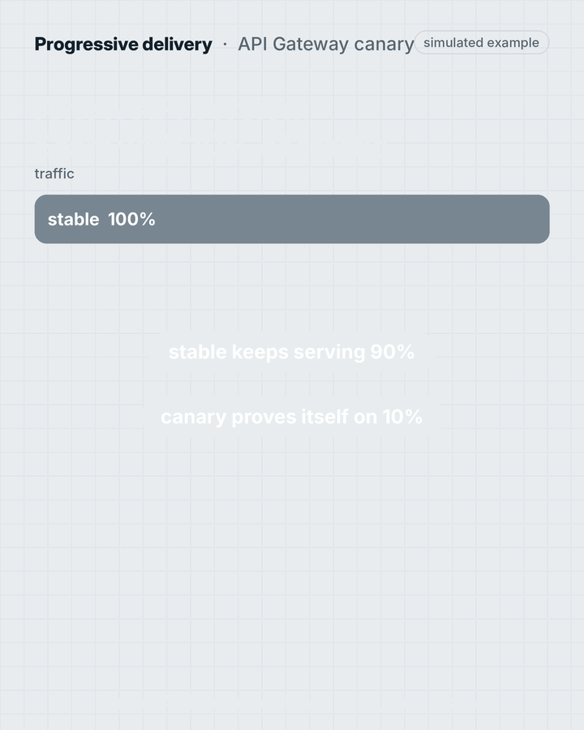
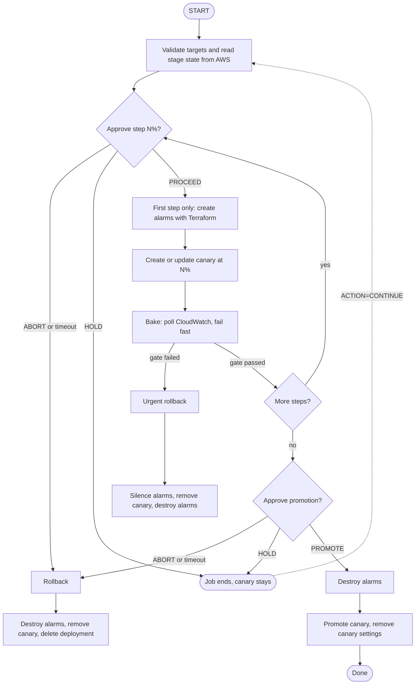
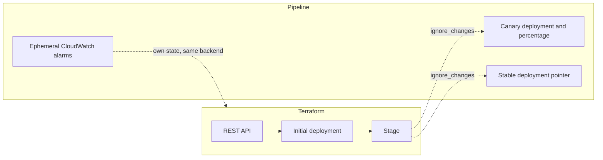

# aws-progressive-delivery

Progressive delivery pipelines for AWS, starting with **API Gateway REST canary releases** driven by a Jenkins shared library.

Terraform builds the API and the stage once. The release pipeline then owns the two pointers that decide what users see:
the stable deployment and the canary. It shifts traffic in steps, watches CloudWatch between steps, asks a human where
you want one, and rolls back on its own when a gate fails. Promotion is the last step and is final.

> Status: API Gateway canary (Jenkins). Lambda alias canary, an ADR comparing it with CodeDeploy, and a GitHub Actions
> version are planned. See [Limitations](#limitations) and [docs/testing-in-your-aws-account.md](docs/testing-in-your-aws-account.md)
> for what has and has not been verified against a real account.

## How a release runs



The animation uses simulated values. The same flow as a diagram:



Alarms are destroyed *before* a planned rollback or a promotion so they cannot fire on the traffic change itself.
An urgent rollback does the opposite: it silences notifications, restores traffic first, and destroys the alarms afterwards,
because traffic operations never wait on Terraform.

## Who owns what



The stage ignores `deployment_id` and `canary_settings` so `terraform apply` never fights a release in flight.
The pipeline itself only calls the AWS CLI for traffic; Terraform appears only for the short-lived alarms, with their own
state in the same remote backend.

## Quick start

1. Apply the example API ([examples/apigw-basic](examples/apigw-basic)) with a remote or local backend
   ([docs/remote-backend.md](docs/remote-backend.md)).
2. Register this repository as a Jenkins global library named `aws-progressive-delivery` (library sources sit at the repo root).
   A local sandbox is in [examples/jenkins-local](examples/jenkins-local).
3. Create a job from [examples/jenkins/Jenkinsfile](examples/jenkins/Jenkinsfile) and run `ACTION=START`.

```groovy
@Library('aws-progressive-delivery') _

progressiveDelivery(
    action: 'START',
    apis: 'orders-api,billing-api@prod',
    mode: 'sequential',
    steps: '10,25,50',
    bakeMinutes: 10,
    gate: [minRequests: 100, max5xxRate: 0.01, maxP99LatencyMs: 1500],
    canary: [stageVariableOverrides: [version: 'v2']],
    monitor: [backend: [type: 's3', config: [bucket: 'my-state-bucket', region: 'us-east-1']]],
)
```

## Actions

| Action | Effect |
| --- | --- |
| `START` | Opens a canary. Fails if the stage already has one. |
| `CONTINUE` | Resumes a canary left on `HOLD`, from the percentage it is at now. State is read from AWS. |
| `PROMOTE` | Promotes an existing canary without further gates. |
| `ROLLBACK` | Removes an existing canary and deletes its deployment. |
| `STATUS` | Prints stable and canary deployments, the last ten minutes of gate metrics and alarm count. |
| `CLEANUP` | Destroys leftover alarms, for example after a failed destroy. |

Approval prompts offer `ABORT` first, so a timeout (60 minutes by default) aborts instead of promoting. The first step cannot be
put on `HOLD`, since nothing has been created yet. `HOLD` ends the job successfully and leaves the canary and its alarms running,
which is how you soak a canary for days between runs.

## Multiple targets

`apis` is a comma separated list of REST API names (the CloudWatch `ApiName`), each optionally `name@stage`.

| Mode | Behaviour |
| --- | --- |
| `single` | Exactly one API. |
| `parallel` | All APIs move in lockstep with shared approvals. Any failure reverts all of them. |
| `sequential` | One API at a time, each fully promoted before the next starts. If a later one fails in the same run you are asked whether to revert the ones already promoted (`onPeerFailure: ask`, default and timeout `REVERT`). After a `HOLD` or the end of a run, promotions are final. |

## Health gate

Between steps the library reads `get-metric-data` for the canary: request count, 5XX rate and optionally p99 latency.
With fewer than `minRequests` the result is *insufficient*, not healthy: the bake is extended up to `maxExtensionMinutes`, and
`requireTraffic: true` turns a still-insufficient result into a failure. The same thresholds drive the CloudWatch alarms
(`5xx-rate` and `p99-latency`) so people are notified while a canary soaks.

## Repository layout

| Path | Contents |
| --- | --- |
| `modules/apigw-canary` | Stage module that hands the pointers to the pipeline |
| `resources/terraform/apigw-monitor` | Root module for the ephemeral alarms, shipped as a library resource |
| `vars/`, `src/progressivedelivery/` | Jenkins shared library |
| `examples/apigw-basic` | Minimal REST API plus stage |
| `examples/jenkins`, `examples/jenkins-local` | Job definition and a Docker Compose sandbox |
| `test/` | Orchestration tests with fakes, no Jenkins or AWS needed |
| `docs/` | Architecture, backends, credentials, IAM, test plan for your own account |

## Tests

```sh
test/run.sh
```

Needs `groovyc` and `groovy` (3.x) on the path. The tests cover config parsing, the health gate, every ordering rule above
(approvals, alarm lifecycle, rollback paths, modes, resume) and the AWS CLI and Terraform command construction. They do not call AWS.

## Limitations

- The library lives at the repository root, so use it as a whole-repo Jenkins library.
- Setting the canary percentage with `update-stage` (`replace /canarySettings/percentTraffic`), the `<stage>/Canary` CloudWatch
  dimension (configurable with `canaryMetricStage`) and the deployment description size limit are not confirmed against AWS docs.
  The checklist in [docs/testing-in-your-aws-account.md](docs/testing-in-your-aws-account.md) covers them.
- Cloudflare R2 as a Terraform backend works without native state locking; see [docs/remote-backend.md](docs/remote-backend.md).

## License

MIT
