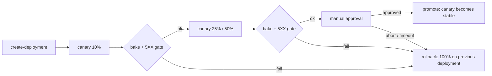

# terraform-aws-apigw-canary

Canary releases for Amazon API Gateway REST APIs: a Terraform module that owns the stage and its canary settings, plus a Jenkins shared library that shifts traffic in steps, gates each step on the canary 5XX rate, and rolls back automatically.

It replaces all-or-nothing stage deployments with a release you can stop at any point.

## How it works



1. The pipeline reads the stage's current deployment (stable) and creates a new deployment from the API definition (canary).
2. For each step, it writes `canary.auto.tfvars.json` and runs `terraform apply`, so every traffic change goes through Terraform and stays in state.
3. After each bake window it reads `Count` and `5XXError` for the canary from CloudWatch and fails the step above the threshold.
4. Promotion sets the canary deployment as stable and removes the canary. Any failure, abort or approval timeout applies the previous stable deployment with no canary.

## Module usage

```hcl
module "stage" {
  source = "github.com/thales-machado/terraform-aws-apigw-canary"

  rest_api_id          = aws_api_gateway_rest_api.this.id
  stage_name           = "prod"
  stable_deployment_id = var.stable_deployment_id
  canary               = var.canary

  stage_variables = {
    version = "v1"
  }

  access_log = {
    destination_arn = aws_cloudwatch_log_group.api.arn
  }
}
```

`canary = null` means no canary: 100% of the traffic on `stable_deployment_id`. To start a canary:

```hcl
canary = {
  deployment_id            = "def456"
  percent_traffic          = 10
  stage_variable_overrides = { version = "v2" }
}
```

The default access log format includes `$context.isCanaryRequest`, so stable and canary traffic can be split in logs.

### Inputs

| Name | Type | Default | Description |
|---|---|---|---|
| `rest_api_id` | `string` | | REST API that owns the stage |
| `stage_name` | `string` | | Stage managed by the module |
| `stable_deployment_id` | `string` | | Deployment serving the stable traffic |
| `canary` | `object` | `null` | `deployment_id`, `percent_traffic` (0–100), `stage_variable_overrides`, `use_stage_cache` |
| `stage_variables` | `map(string)` | `{}` | Stage variables |
| `description` | `string` | `null` | Stage description |
| `xray_tracing_enabled` | `bool` | `false` | X-Ray tracing |
| `cache_cluster_enabled` | `bool` | `false` | Stage cache |
| `cache_cluster_size` | `string` | `null` | Stage cache size |
| `access_log` | `object` | `null` | `destination_arn`, optional `format` |
| `tags` | `map(string)` | `{}` | Tags |

### Outputs

`stage_name`, `stage_arn`, `invoke_url`, `execution_arn`, `stable_deployment_id`, `canary_deployment_id`, `canary_percent_traffic`.

## Jenkins usage

Register this repository as a global shared library named `apigw-canary` (the library lives in `vars/`), then:

```groovy
@Library('apigw-canary@main') _

apigwCanary(
    restApiId: 'a1b2c3d4e5',
    apiName: 'orders-api',
    stageName: 'prod',
    tfDir: 'infra/api',
    steps: [10, 25, 50],
    bakeMinutes: 10,
    max5xxRate: 0.01,
)
```

| Option | Default | Description |
|---|---|---|
| `restApiId`, `apiName`, `stageName` | required | Target API and stage |
| `tfDir` | `.` | Root module that passes `stable_deployment_id` and `canary` to this module |
| `steps` | `[10, 25, 50]` | Traffic percentages before promotion |
| `bakeMinutes` | `10` | Wait and metric window per step |
| `max5xxRate` | `0.01` | Maximum canary 5XX rate per step |
| `minRequests` | `100` | Below this, the gate is skipped (or fails with `requireTraffic: true`) |
| `manualPromotion` | `true` | Ask for approval before promoting |
| `approvalTimeoutMinutes` | `60` | Timeout for the approval, which triggers a rollback |
| `stageVariableOverrides` | `[:]` | Stage variables for the canary only |
| `canaryMetricStage` | `<stage>/Canary` | CloudWatch `Stage` dimension of canary metrics |
| `region` | `us-east-1` | AWS region |

Full pipeline: [`examples/jenkins/Jenkinsfile`](examples/jenkins/Jenkinsfile). The agent needs `terraform`, the AWS CLI, GNU `date` and credentials allowed to call `apigateway:*` on the API and `cloudwatch:GetMetricStatistics`. Keep `disableConcurrentBuilds()`: two releases on the same stage would overwrite each other.

## Try it

```bash
cd examples/basic
terraform init && terraform apply
curl "$(terraform output -raw health_url)"
# {"version": "v1", "canary": false}
```

Then run the Jenkins example against the `rest_api_id` output, or reproduce one step by hand with `aws apigateway create-deployment` and a `canary.auto.tfvars.json` based on [`canary.auto.tfvars.json.example`](examples/basic/canary.auto.tfvars.json.example). During the canary, about 10% of the responses come back with `"version": "v2", "canary": true`.

## Requirements

- Terraform >= 1.5
- AWS provider >= 5.75, where `canary_settings.deployment_id` was added; earlier versions routed all canary traffic to the main deployment
- REST APIs only: HTTP APIs do not support canary releases
- Use a remote backend in real pipelines, since each step is a `terraform apply`

## Limitations

- The gate checks the canary 5XX rate only. Latency or business metrics can be added in `assertHealthy`.
- Deployments created by the pipeline are not in Terraform state, so older ones are not cleaned up.

## License

MIT
