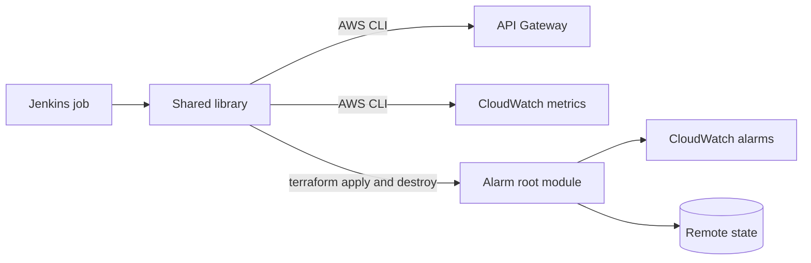
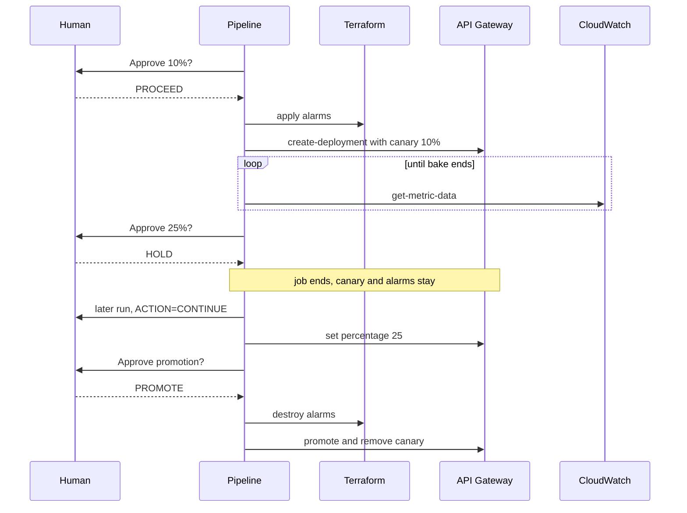

# Architecture

## Components

`Orchestrator` holds the release logic and talks only to three interfaces: `Pipeline` (the CI system), `Gateway` (API Gateway and
CloudWatch) and `Monitor` (alarms). Jenkins, the AWS CLI and Terraform sit behind them, and the tests replace all three with fakes.

## Deployments and the canary

An API Gateway deployment is an immutable snapshot of the API. A stage points at one (`deploymentId`) and may carry
`canarySettings` with a second deployment and the percentage of requests it receives.

| Step | Call |
| --- | --- |
| Create canary | `create-deployment --canary-settings '{"percentTraffic":10.0,...}'` creates the deployment and the canary together |
| Change percentage | `update-stage` with `replace /canarySettings/percentTraffic` |
| Promote | `update-stage`: percentage to `0.0`, copy variable overrides, `copy /canarySettings/deploymentId -> /deploymentId`; then `remove /canarySettings` |
| Roll back | `update-stage remove /canarySettings`, then `delete-deployment` |

Because creating the deployment and starting the canary is one call, the candidate deployment appears right after the first
step is approved, not before.

## Release timeline

## Rollback ordering

| Cause | Order |
| --- | --- |
| Human abort, approval timeout | destroy alarms, remove canary, delete deployment |
| Gate failure, command failure | silence alarm actions, remove canary, delete deployment, destroy alarms |
| Alarm destroy fails | continue, silence the alarms, mark the build unstable, run `ACTION=CLEANUP` later |

Planned changes destroy the alarms first so the traffic change cannot trip them. Urgent ones restore traffic first because it must
not depend on Terraform being healthy.

## Bake and soak

A **bake** is the short wait inside one run where the pipeline polls metrics and can fail fast. A **soak** is a long observation
between runs: you answer `HOLD`, the job ends, and `CONTINUE` later picks up from the percentage the stage reports.

## State

There is no manifest and no parameter store. The release state is the stage itself. The canary deployment carries a
marker in its description (`aws-progressive-delivery:<build tag>`); `CONTINUE` refuses a canary without it unless
`adoptForeignCanary: true`. Alarm state is a separate Terraform state per `apiId/stage` in the same backend:
`<keyPrefix>/<apiId>/<stage>/monitor.tfstate`.

## Alarms

| Alarm | Definition |
| --- | --- |
| `<namePrefix>-<apiName>-<stage>-5xx-rate` | `IF(requests >= min, errors / requests, 0)` on the canary dimension |
| `<namePrefix>-<apiName>-<stage>-p99-latency` | Optional, p99 gated by the same minimum request count |

Missing data is treated as not breaching, so an idle canary stays quiet.
